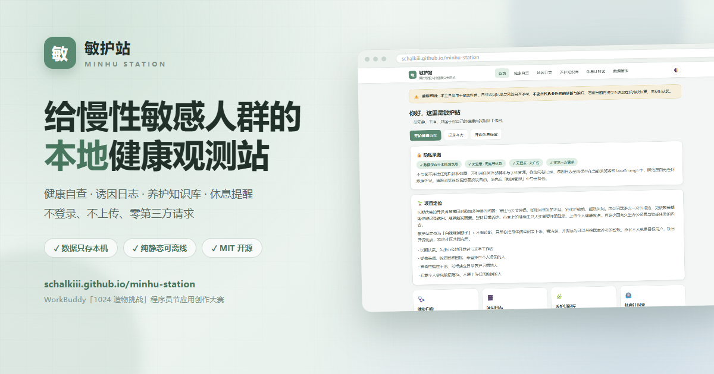
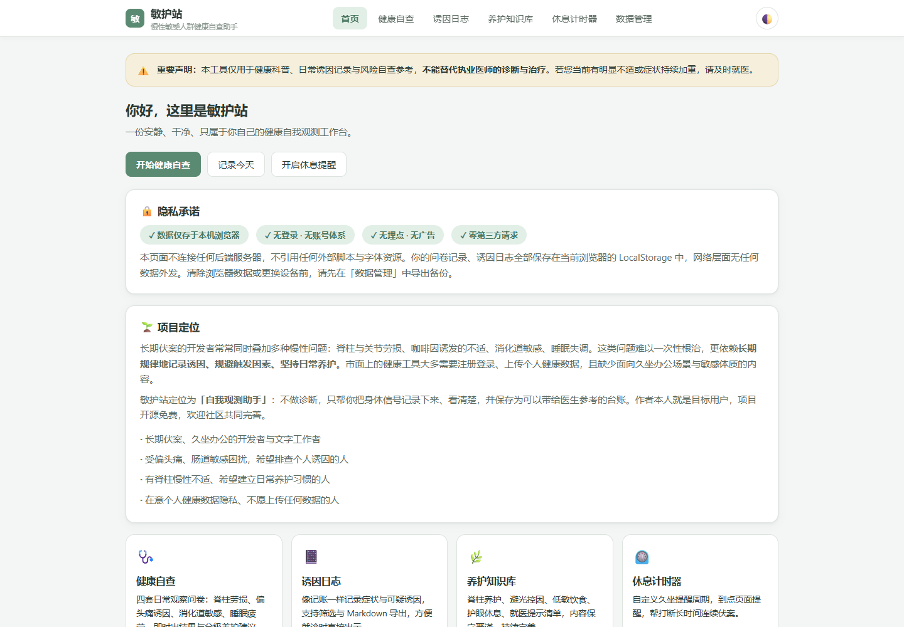
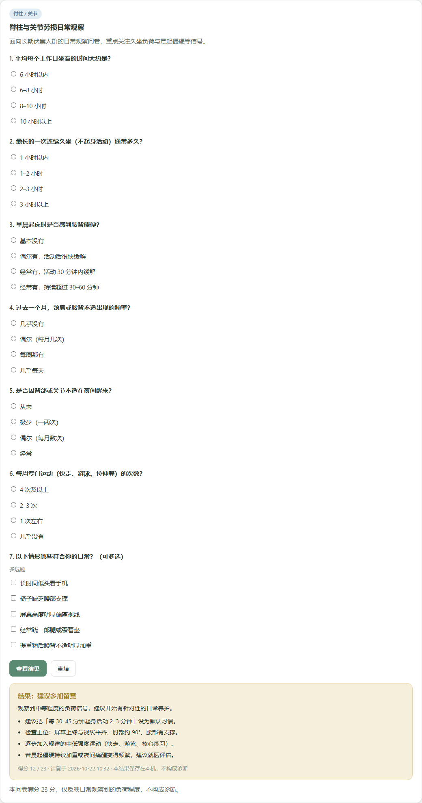
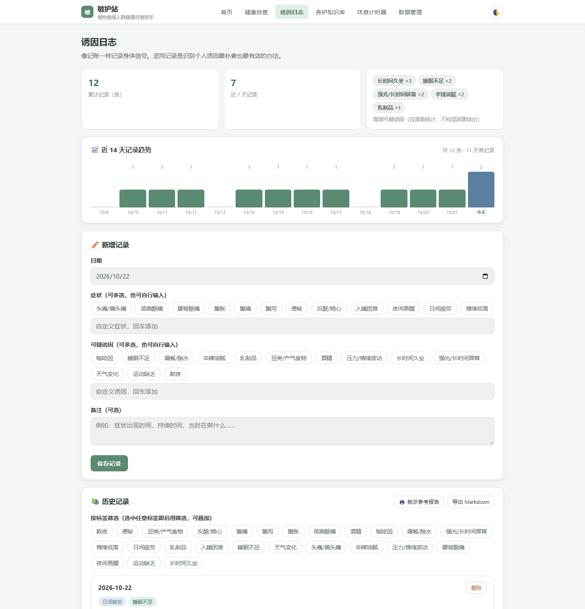
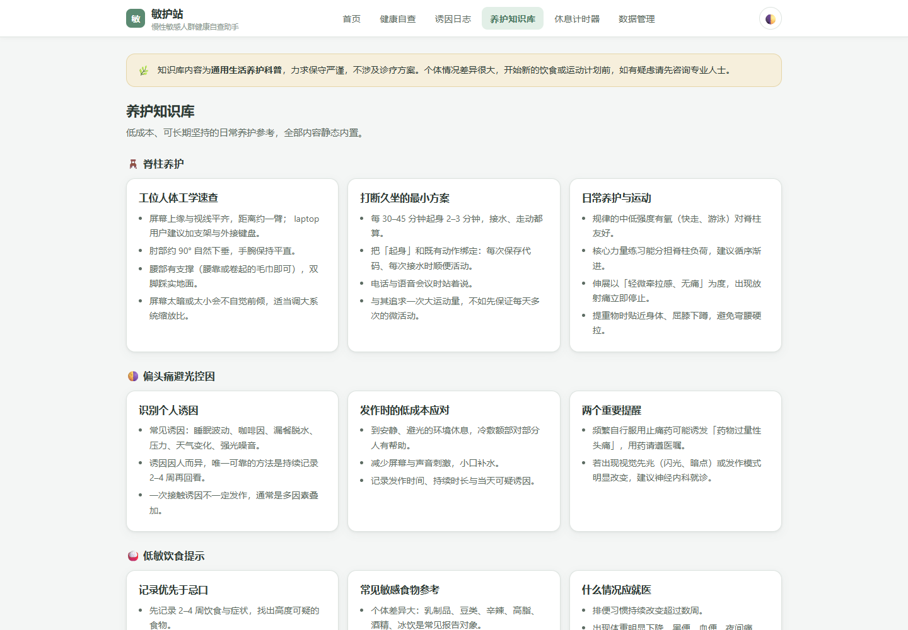
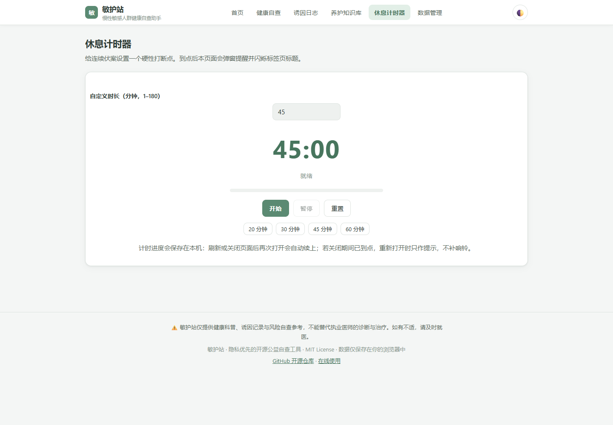
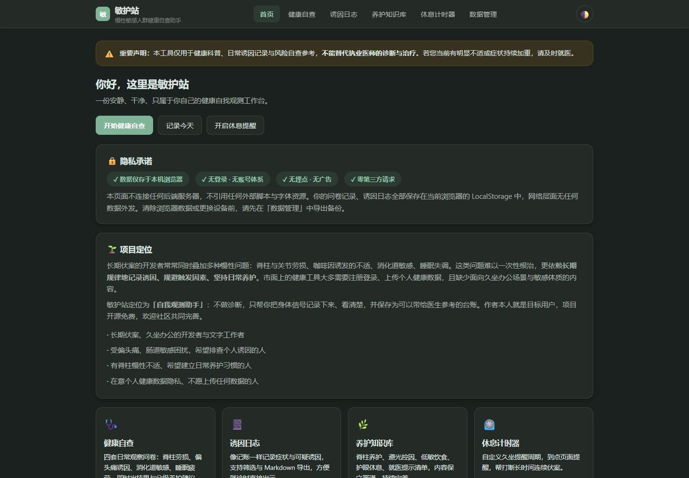
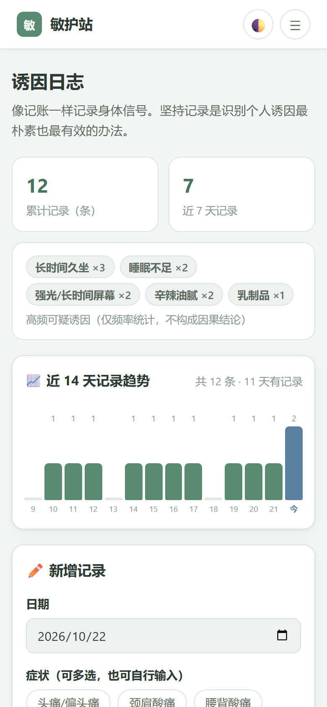

# 敏护站 · 慢性敏感人群健康自查助手

> 一个隐私优先、零外部依赖的开源健康自我观测工作台：健康自查、诱因日志、14 天趋势、就诊参考报告、养护知识库、休息计时器。
>
> **🔗 在线体验：[https://schalkiii.github.io/minhu-station/](https://schalkiii.github.io/minhu-station/)**
>
> 🎯 参赛作品 | WorkBuddy「1024 造物挑战」程序员节应用创作大赛
> 📦 部署方式：GitHub Pages（纯静态，无后端、无构建步骤）
> 🔒 隐私承诺：所有用户记录仅存储在浏览器 LocalStorage，**不会上传任何数据到服务器**；无登录、无埋点、无广告，且**零第三方请求**——页面不引用任何 CDN、外部字体或统计脚本，网络层面无任何数据外发
> ⚠️ 重要声明：本工具仅用于健康科普、诱因记录、风险参考，**不能替代医生诊断**，出现不适请及时就医

[](https://schalkiii.github.io/minhu-station/)
[](LICENSE)
[](#-技术栈)
[](#-隐私设计)



## ✨ 项目背景

很多长期伏案的开发者，同时面临脊柱劳损、偏头痛、消化道敏感、睡眠紊乱等慢性问题。这类问题的重点在于长期记录诱因、规避触发因素、坚持日常养护，而不是期待一次性根治。

但现有工具要么需要注册并上传个人健康数据，要么面向普通大众，缺少针对久坐办公场景与慢性敏感体质的内容。本项目是开源公益工具，作者本人也是目标用户，希望提供一个轻量化、隐私安全的自查与记录工作台。

**项目边界：不做诊断，只做「自我观测助手」。** 所有问卷措辞为日常观察项，结果仅分为「日常观察 / 建议多加留意 / 建议尽快就医评估」三级，全程回避诊断话术，并在页面显眼位置与页脚保留免责声明。

## 🧩 核心功能

### 1. 多维度健康自查

- 四套日常观察问卷：脊柱 / 关节劳损、偏头痛诱因、消化道敏感、睡眠与疲劳
- 即时本地计算得分，输出三级分级提示 + 配套温和养护建议
- 问卷结果自动保存，再次打开自动恢复上次结果
- 每套问卷可独立「重填」，同时清除本机保存的对应结果

### 2. 诱因日志与趋势

- 记录日期、症状、可疑诱因（预设标签 + 自定义标签）、备注
- 统计概览：累计记录、近 7 天记录、高频可疑诱因 Top 5（仅频率统计，不做因果断言）
- **近 14 天记录趋势图**：纯 DOM/CSS 绘制，不引入任何图表库
- 支持标签叠加筛选；单条删除带二次确认
- 一键导出 Markdown 台账，可直接交给医生参考

### 3. 就诊参考报告

- 一键汇总「问卷结果 + 记录概况 + 日志明细」为 A4 打印版报告
- 使用浏览器原生打印即可「另存为 PDF」，全程本地生成，不上传任何内容
- 适合在就诊前整理好个人观察记录，提高沟通效率

### 4. 养护知识库

- 卡片式静态知识库：脊柱养护、偏头痛避光控因、低敏饮食、护眼休息、就医提示清单
- 内容保守严谨、持续完善，不涉及诊疗方案

### 5. 久坐休息计时器

- 自定义 1–180 分钟周期，预设 20/30/45/60 分钟
- 到点页面弹窗提醒 + 标签页标题闪烁 + 本地生成的提示音（无外部音频文件）
- **计时进度持久化**：刷新或关闭页面后再次打开会自动续上；关闭期间到点则只提示、不补响铃
- 计时中标签页标题显示剩余时间，切到其他页面也能看到

### 6. 数据管理

- 导出全部本地数据为 JSON 备份、合并导入（自动校验与去重）
- 一键清空（二次确认）、本地存储用量统计
- **示例数据**：一键载入一组虚构记录，快速预览统计、趋势图与报告效果

### 7. 体验与可访问性

- URL 深链：`#/check`、`#/log`、`#/knowledge`、`#/timer`、`#/data` 可直接打开对应页面，支持浏览器前进/后退
- 深色模式（跟随系统 + 手动切换，首屏无闪烁）
- 移动端汉堡菜单，全站响应式
- 键盘可见焦点、Esc 关闭弹窗、弹窗焦点回归、`aria-live` 状态提示、`prefers-reduced-motion` 适配
- 完整 Open Graph / Twitter Card / JSON-LD 元信息，便于分享与检索

## 🔐 隐私设计

- 所有数据（问卷结果、诱因日志、偏好设置、计时进度）仅保存在浏览器 `localStorage`，键名 `minhu-station-data-v1`
- **整站零外部依赖**：无 Tailwind CDN、无 Google Fonts、无任何统计脚本。打开页面时网络层面不产生任何第三方请求
- 题库与知识库内嵌于页面静态 JSON，本地双击 `index.html` 亦可完整运行（无 CORS 问题）
- 导出 / 导入 / 打印报告全部在本地完成
- 没有账号体系，也就没有「注销账号」「数据被平台留存」的问题；清除浏览器数据或更换设备前，请在「数据管理」中导出备份

## 📸 界面预览

### 首页



### 健康自查



### 诱因日志与 14 天趋势



### 养护知识库 / 休息计时器

<p align="center">
  
  
</p>

### 深色模式 / 移动端

<p align="center">
  
  
</p>

## 🚀 在线体验与部署

**在线体验：[https://schalkiii.github.io/minhu-station/](https://schalkiii.github.io/minhu-station/)**

本项目是纯前端静态页面，不需要后端服务、不需要构建：

1. Fork / Clone 本仓库
2. 仓库 Settings → Pages，Source 选择 `Deploy from a branch`，分支 `main`、目录 `/ (root)`
3. 访问 `https://<yourname>.github.io/minhu-station/`
4. 也可以直接本地双击 `index.html` 运行，功能完全一致

本地起一个静态服务器（可选）：

```bash
python -m http.server 4173
# 打开 http://localhost:4173/
```

## 🛠️ 技术栈

- 单文件 `index.html`：手写 CSS（CSS 变量双主题）+ Vanilla JavaScript
- 无框架、无构建步骤、无任何外部依赖
- LocalStorage 本地持久化（单一版本化键，向前兼容）
- 数据导出：Markdown / JSON / 浏览器打印 PDF（Blob + 下载，无服务器参与）
- 部署：GitHub Pages + `.nojekyll`

## 📁 目录结构

```text
minhu-station/
├── index.html                  # 应用本体（结构 / 样式 / 逻辑）
├── assets/
│   ├── og-cover.png            # 1200×630 分享封面
│   └── share-poster.png        # 1080×1440 竖版海报
├── docs/screenshots/           # README 与参赛截图
├── submission/                 # 参赛文案与报名信息草稿
├── README.md
└── LICENSE
```

## ✅ 已验证

- Chrome / Edge（桌面 1440×1000、移动 390×844）可正常完成自查、记录、筛选、删除、计时、备份、报告打印
- 页面加载与交互过程中 **0 个第三方网络请求**、**0 条控制台错误**
- 本地 `file://` 直接打开可正常读写 LocalStorage
- 计时器在刷新后能按绝对结束时间恢复；时区相关日期使用本地日历日计算

## 🧭 使用建议

1. 花 3–5 分钟完成与你相关的自查问卷，了解当前观察基线
2. 日常在「诱因日志」随手记录症状与可疑诱因，坚持 2–4 周
3. 翻看「养护知识库」，选择 1–2 项低成本的干预习惯开始尝试
4. 开启「休息计时器」，让定时起身成为默认动作
5. 就诊前生成「就诊参考报告」，或导出 Markdown 台账交给医生参考

## 📌 参赛信息

- 赛事：WorkBuddy「1024 造物挑战」程序员节应用创作大赛
- 作品形态：网页应用
- 作者：schalkiii
- 作品宣言：**这个 1024，我做了一个慢性敏感人群健康自查助手，让长期伏案的开发者把身体信号记下来、看明白。**
- 作品介绍：敏护站是一个隐私优先的纯静态健康自我观测工具，面向受脊柱劳损、偏头痛、消化道敏感、睡眠紊乱困扰的长期伏案人群。提供四套日常观察问卷、带 14 天趋势的诱因日志、可打印的就诊参考报告、养护知识库与久坐休息计时器。所有数据只保存在浏览器本地，无登录、无埋点、零第三方请求，打开即可使用。
- 在线体验：https://schalkiii.github.io/minhu-station/
- 开源仓库：https://github.com/schalkiii/minhu-station

参赛文案、社媒分享文案与报名信息见 [`submission/参赛文案.md`](submission/参赛文案.md)。

## 🗓️ 更新日志

### v1.1.0（2026-10-22）

- 修复「重填」按钮因函数名错误导致的运行时异常，并同步清除已保存结果
- 新增 URL 深链与浏览器前进/后退支持
- 新增近 14 天记录趋势图、高频诱因标签化展示
- 新增就诊参考报告（浏览器打印 / 另存 PDF）
- 计时器改为绝对时间计时，支持刷新/关闭后续上，并在标签页标题显示倒计时
- 新增示例数据载入、首屏主题预加载（消除深色模式闪烁）
- 完善移动端统计卡与趋势图布局、键盘焦点、Esc 关闭、`aria-live`、减少动态效果适配
- 补充 Open Graph / Twitter Card / JSON-LD / canonical 元信息
- 日期统一改为本地日历日计算，修复 UTC 时区导致的跨日偏差

### v1.0.0

- 首个版本：四套自查问卷、诱因日志、知识库、休息计时器、数据管理、深色模式

## 🤝 开源说明 & 贡献

开源协议：MIT

欢迎提交 PR 补充科普文案、优化问卷、增加适配场景。贡献要求：

- 科普内容保守严谨，不出现医疗断言与诊疗方案
- 保持「零外部请求」约束：不引入 CDN、外部字体、统计脚本
- 保留免责声明；结果分级沿用「日常观察 / 建议多加留意 / 建议尽快就医评估」三级措辞，不使用「高危 / 诊断」类表述

## 📄 License

[MIT](LICENSE)
